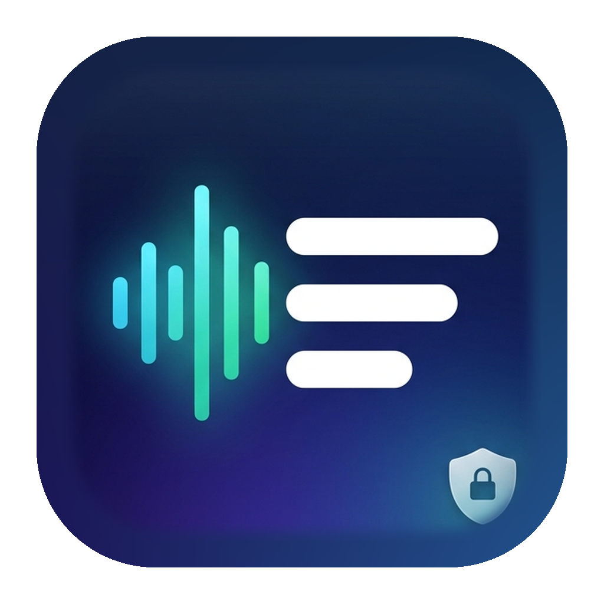
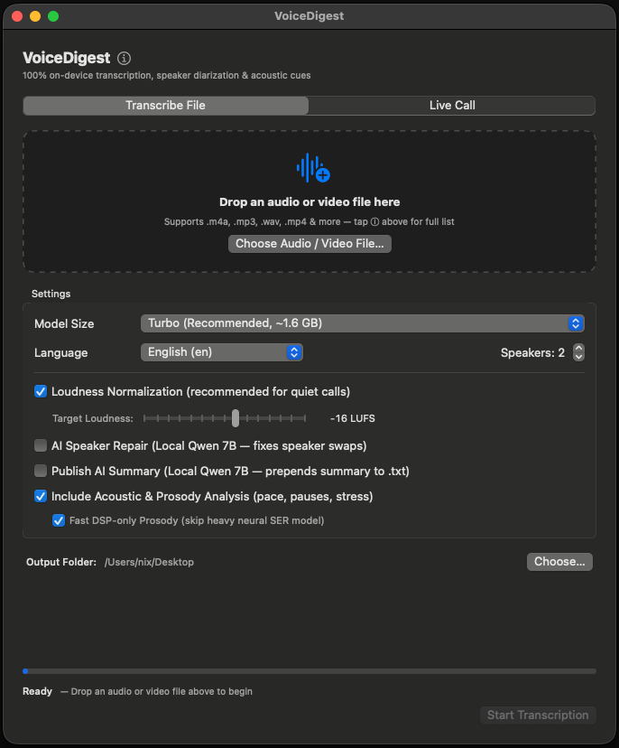
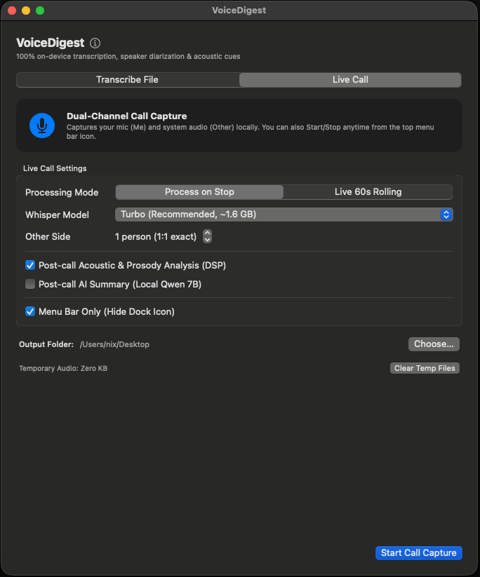
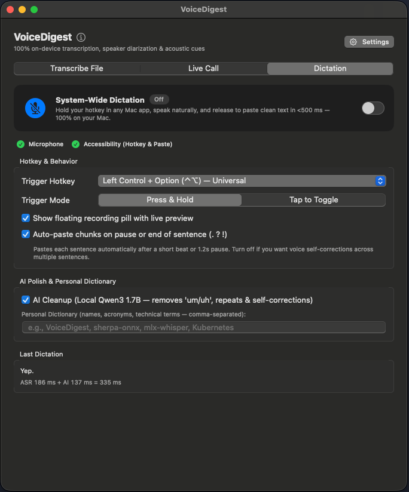
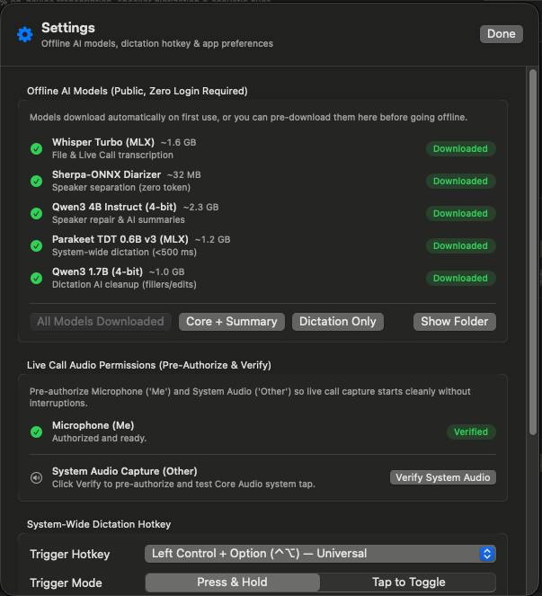

<p align="center">
  
</p>

<h1 align="center">VoiceDigest</h1>

<p align="center">
  <strong>100% private macOS app & CLI for audio/video transcription, live call capture, <500 ms system-wide dictation, acoustic prosody analysis, and on-device AI summaries — powered by Apple Silicon.</strong><br/>
  Everything stays 100% on your Mac — never uploaded to the cloud, external servers, or any AI company. Zero Ollama. Zero Hugging Face tokens.
</p>

<p align="center">
  <a href="https://github.com/n-nayak/local-voice-digest/releases">
    
  </a>
</p>

<p align="center">
  
  
  
</p>

<p align="center">
  
  &nbsp;
  
</p>
<p align="center">
  
  &nbsp;
  
</p>

---

## What Makes VoiceDigest Different?

Most local transcription tools stop at plain text — or require setting up Ollama, virtual audio drivers (BlackHole), or gated Hugging Face tokens. **VoiceDigest** ships as one self-contained Mac app that captures **what was said**, **how it was said**, and **what matters**:

- **<500 ms System-Wide Dictation (Wispr Flow–Style, 100% On-Device):** Hold your chosen modifier hotkey (`Right Option ⌥`, `⌃⌥`, `Right ⌥⌘`, `Right ⌘`, or `Fn`) in any Mac app, see live streaming preview text in the floating bubble, and release to auto-paste polished text (or enable optional auto-paste chunks on pauses / end of sentence; press `Esc` to cancel). Powered by a warm local **Parakeet TDT 0.6B v3** + **Qwen3-1.7B-4bit** daemon with active window context, Personal Dictionary, and clipboard preservation.
- **Acoustic & Prosody Biomarkers (`--prosody`):** Measures speaking pace (WPM), mid-clause hesitation blocks, prolongations, and speaker-normalized vocal stress (`openSMILE` eGeMAPS + DSP) — built for interview prep, sales calls, and communication coaching.
- **Native Menu-Bar Live Call Capture (macOS 14.2+):** Captures your mic (`Me`) and system audio (`Other` / `1:N`) natively via **Core Audio Process Tap** — no meeting bots, no BlackHole driver, and no *Screen Recording* permission required.
- **All-in-One Apple Silicon MLX Stack:** Runs `mlx-whisper` (Metal GPU), `parakeet-mlx` (ultra-fast dictation), `sherpa-onnx` (English WeSpeaker VoxCeleb diarization), and `Qwen3-4B-Instruct-2507-4bit` (`mlx-lm` speaker-swap repair + map-reduce summarization, non-thinking mode) directly inside one `.app` with automatic public model downloads (zero login or tokens).
- **Strict Air-Gap Enforcement:** Sets `HF_HUB_OFFLINE=1` / `TRANSFORMERS_OFFLINE=1` before ML imports and installs a Python socket-level outbound network blocker during inference.
- **Broad Audio & Video Support:** Decodes `.m4a`, `.mp3`, `.wav`, `.ogg`/`.opus`, `.flac`, `.aac`, `.aiff`, `.caf`, `.wma`, and extracts audio tracks from `.mp4`, `.mov`, `.mkv`, and `.webm` via bundled `ffmpeg` with configurable EBU R128 loudness normalization (`-24` to `-10 LUFS`).

---

## Sample Output

```text
=== AI SUMMARY ===
- Discussed deployment timeline and rollout milestones for Q3.
- Key concern: narrow release window requires earlier QA sign-off.
- Action item: Speaker 1 to share updated dependency checklist by Thursday.
==================

=== SESSION ACOUSTIC SUMMARY ===
Duration: 58m 14s | Speakers: 2
speaker 1: Avg Pace: 138 WPM (Normal) | Acoustic Disfluencies: 2  | Elevated Stress Turns: 5%
speaker 2: Avg Pace: 184 WPM (Fast)   | Acoustic Disfluencies: 11 | Elevated Stress Turns: 34%
================================

speaker 1 [pace: 135 WPM | state: calm]: Good morning, thanks for making time to go over the project timeline today.
speaker 2 [pace: 192 WPM (fast) | disfluency: 2 blocks | state: tense]: Happy to be here. I have a few concerns about the deployment window we discussed last week.
speaker 1 [pace: 141 WPM | state: calm]: Let's dive right into those blockers first.
```

---

## Install the Mac App (No Terminal Required)

1. Download **`VoiceDigest.dmg`** from the [**GitHub Releases**](https://github.com/n-nayak/local-voice-digest/releases) page.
2. Open the `.dmg` and drag **VoiceDigest** into **Applications**.
3. **First launch (macOS Gatekeeper):** Because this preview build is ad-hoc signed, **Right-click `VoiceDigest.app` → Open → Open** (or **System Settings → Privacy & Security → Open Anyway**) once — after that, it opens normally.
4. Drop an audio/video file, start a **Live Call**, or turn on **Dictation** (open **Settings** in the top-right to pre-download all public models and pre-authorize Microphone, System Audio, and Accessibility). Models cache in `~/Library/Application Support/VoiceDigest/models/` with zero tokens or logins required.

---

## Quick Start (CLI / Developers)

### 1. Prerequisites
- macOS (Apple Silicon recommended) or Linux, Python 3.11+
- `ffmpeg` (`brew install ffmpeg` on macOS)

### 2. Install Dependencies
```bash
uv venv --python 3.11
source .venv/bin/activate
uv pip install -e ".[prosody,mlx]"
```

### 3. One-Time Model Download (No HF Token Required)
```bash
# Transcription, diarization & meeting LLM (Qwen3-4B)
python transcribe.py --download-models --asr-backend mlx --model-size turbo --diarizer sherpa-onnx --llm-repair --model-dir ./models

# Optional: System-wide dictation models (Parakeet v3 + Qwen3-1.7B)
python transcribe.py --download-models --dictation-models --model-dir ./models
```

### 4. Run Offline Transcription
```bash
python transcribe.py recording.m4a \
  --speakers 2 \
  --asr-backend mlx \
  --model-size turbo \
  --diarizer sherpa-onnx \
  --language en \
  --llm-repair \
  --summary --summary-focus "Key takeaways, decisions, and action items" \
  --prosody --no-ser \
  --cache-dir ./.cache \
  --output transcript.txt
```

---

## Build `VoiceDigest.app` & `VoiceDigest.dmg` from Source

```bash
chmod +x scripts/build_dmg.sh

# Lightweight dev build (uses your local .venv)
./scripts/build_dmg.sh

# Self-contained build (bundles standalone MLX/Sherpa-ONNX backend + ffmpeg inside the .app)
uv pip install pyinstaller
./scripts/build_dmg.sh --self-contained
```

---

## Running Tests

```bash
python -m unittest discover -s tests -v
```

---

## Legal & Recording Consent Notice

VoiceDigest is an on-device application designed for local audio transcription and note-taking. You are solely responsible for complying with all applicable laws regarding audio recording and participant consent as well as any workplace NDA policies before capturing live calls.

---

## License

MIT License — see [LICENSE](LICENSE) for details.
