# VoiceDigest — Architecture Deep Dive

## 1. Overview

**VoiceDigest** is a 100% private, on-device macOS desktop application and Python CLI for:
1. **Long-form Audio/Video Transcription & Live Call Capture** (with speaker separation, acoustic/prosodic biomarkers, and focused AI summaries), and
2. **<500 ms System-Wide Dictation** (press-and-hold global hotkey with instant auto-paste into any Mac app).

Everything stays 100% on your Mac — never uploaded to the cloud, external servers, or any AI company. Architecturally, it pairs a native **SwiftUI** front-end, **macOS Core Audio** dual-stream capture engine, and **`CGEventTap`** global dictation controller with two decoupled Apple Silicon MLX pipelines:
- **Async Meeting Pipeline:** `FFmpeg → MLX-Whisper → Sherpa-ONNX Diarization → Local Qwen3-4B Speaker Repair & Map-Reduce Summarization → openSMILE Prosody` (sequential model unloading keeps peak RAM around **~2–3 GB**).
- **Warm Dictation Daemon:** Persistent background JSON-RPC worker keeping `Parakeet TDT 0.6B v3` + `Qwen3-1.7B-4bit` hot in unified memory (~2.2 GB) when Dictation is enabled, achieving **~280–430 ms** end-to-end paste latency at 200 WPM.

The entire stack uses **100% public, ungated models** (zero Hugging Face tokens, zero Ollama, zero Homebrew) and packages into a standalone drag-and-drop `VoiceDigest.dmg`.

---

## 2. End-to-End Architecture

```mermaid
flowchart TD
    subgraph Meeting["Long-Form File & Live Call Pipeline (Async)"]
        A["Input: Audio/Video File or Live Call<br/>Mic + Core Audio Process Tap"] --> B["Stage 1: FFmpeg Preprocessor<br/>16 kHz mono PCM, EBU R128 loudnorm, RMS silence gate"]
        B --> C["Stage 2: Speech-to-Text (ASR)<br/>mlx-whisper on Apple Silicon GPU<br/>or WhisperX on CUDA / CPU"]
        B --> D["Stage 3: Speaker Separation<br/>File: Sherpa-ONNX pyannote + English WeSpeaker<br/>Live: Hardware split Mic = Me, System = Other"]
        C --> E["Stage 4: Alignment & Smoothing<br/>Sentence-boundary majority vote + Turn merging"]
        D --> E
        E --> F["Stage 4b (Optional): Local LLM Speaker Repair<br/>Qwen3-4B-Instruct-2507-4bit (non-thinking)<br/>Sliding 24-sentence chunks + pause cues"]
        F --> G["Stage 5 (Optional): Acoustic & Prosody Engine<br/>openSMILE eGeMAPS + DSP<br/>WPM, hesitation blocks, prolongations, stress"]
        F --> H["Stage 5b (Optional): Local AI Summary<br/>Qwen3-4B-Instruct-2507-4bit<br/>Single-pass or Map-Reduce for 1-3+ hr calls"]
        G --> I["Stage 6: Output Formatter (.txt)<br/>AI Summary + Acoustic Summary + Speaker Turns"]
        H --> I
    end

    subgraph Dictation["System-Wide Dictation Pipeline (<500 ms Warm Daemon)"]
        D1["Global Hotkey (CGEventTap)<br/>Press & Hold + Floating HUD Pill"] --> D2["Short-Clip Mic Capture (AVAudioRecorder)<br/>+ Active App/Window Context (AXUIElement)"]
        D2 --> D3["Warm Python JSON-RPC Daemon<br/>Parakeet TDT 0.6B v3 (~90-160 ms)"]
        D3 --> D4["Optional AI Cleanup (Default ON)<br/>Qwen3-1.7B-4bit non-thinking (~160-240 ms)<br/>+ Personal Dictionary + Length Guard"]
        D4 --> D5["Clipboard-Safe Auto-Paste<br/>Save Clipboard -> CGEvent Cmd+V -> Restore"]
    end
```

---

## 3. Component-by-Component Deep Dive

### A. Audio Capture & Preprocessing
* **Why convert `.m4a`/`.mp4` to 16 kHz mono PCM WAV via `FFmpeg`?**
  * Neural speech models cannot read compressed AAC/MP3 containers directly — they expect a raw 1D waveform array at 16,000 samples/second (`float32` / `int16`).
  * Decoding **once** up front lets all downstream stages share one exact timeline (preventing timestamp drift from AAC priming offsets) and enables **instant byte-offset seeking** (`byte = t × 16,000 × 2`) so prosody can read short turn slices without loading a 1-hour file into RAM.
* **Why EBU R128 Loudness Normalization (`loudnorm` to `-16 LUFS`)?**
  * Real-world call recordings are often `-40` to `-55 dBFS` (~30 dB quieter than studio speech). `loudnorm` raises speech uniformly to the configured target (`-24` to `-10 LUFS`, default `-16`) without amplifying silence or room tone.
* **Native macOS 14.2+ Dual-Stream Live Call Capture (Zero Virtual Drivers):**
  * **Mic (`Me`):** Apple's `AVAudioRecorder` writes 16 kHz mono PCM directly to `mic.wav`, with explicit `AVCaptureDevice.requestAccess(for: .audio)` permission handling.
  * **System Audio (`Other`):** macOS 14.2's **Core Audio Process Tap** (`AudioHardwareCreateProcessTap`) wrapped in a private Aggregate Device streams Zoom/Meet/Teams audio into a direct pure-Swift 16 kHz PCM16 WAV writer — no BlackHole driver and no *Screen Recording* permission required.
  * **Zero-Collision Sessions & Cleanup:** Each call writes to `~/Library/Caches/VoiceDigest/sessions/<timestamp>_<uuid>/`, followed by immediate auto-deletion on completion and an orphan sweep on launch.

### B. Long-Form ASR (`mlx-whisper`) & Speaker Diarization (`sherpa-onnx`)
* **`mlx-whisper` on Apple Silicon:** Runs OpenAI Whisper natively on the Apple Silicon Metal GPU with unified memory (~3 minutes for a 1-hour `turbo` call vs. 15–20 minutes on CPU `faster-whisper`).
* **Anti-Hallucination Safeguards:** Two-layer defense against Whisper silence hallucinations: (1) RMS energy gate (`RMS < 0.0005` ≈ `-66 dBFS`) before `loudnorm`/ASR, and (2) `condition_on_previous_text=False` + filtering segments with `no_speech_prob > 0.6`.
* **`sherpa-onnx` Diarization:** Runs `pyannote-segmentation-3.0` + English `WeSpeaker VoxCeleb ResNet34-LM` in ONNX Runtime (~32 MB total, zero HF token, no PyTorch MPS clustering collapse), followed by duration-weighted sentence-boundary majority smoothing so sentences are never split mid-clause.

### C. Decoupled Dual-LLM Strategy (`Qwen3-4B` vs. `Qwen3-1.7B`)
Asking a single LLM to handle both real-time `<500 ms` dictation and multi-speaker long-form meeting reasoning forces unacceptable compromises. VoiceDigest decouples them:
1. **Meeting Speaker Repair & Summarization — `mlx-community/Qwen3-4B-Instruct-2507-4bit` (~2.3 GB disk, ~3 GB RAM):**
   * Dedicated non-thinking mode (`enable_thinking=False`) eliminates chain-of-thought latency while matching/exceeding `Qwen2.5-7B-Instruct` at nearly half the memory footprint.
   * **Zero Text Mutation for Speaker Repair:** Receives 24-sentence sliding chunks (+ 5-sentence prior labeled context and `[pause Xs]` cues) and outputs **only** a JSON map `{sentence_id: speaker_int}` under greedy decoding (`temp=0.0`), preserving every word and timestamp verbatim.
   * **Map-Reduce Summarization:** Single-pass for short recordings ($\le 12,000$ chars); automatic Map-Reduce chunking for 1–3+ hour calls guided by an optional 160-char focus prompt.
2. **Live System-Wide Dictation — `mlx-community/parakeet-tdt-0.6b-v3` + `mlx-community/Qwen3-1.7B-4bit` (~2.2 GB total warm RAM):**
   * **Why Parakeet TDT instead of Whisper for dictation?** NVIDIA's FastConformer TDT is non-autoregressive and runs ~5–10× faster than autoregressive Whisper on short clips (**~90–160 ms** on M-series), leaving ample headroom for LLM cleanup inside the `<500 ms` budget.
   * **Warm Persistent Daemon:** Spawning Python cold takes ~2–3 seconds. When Dictation is enabled, Swift spawns a persistent `transcribe.py --dictation-daemon` over newline-delimited JSON on `stdin`/`stdout` (unloaded immediately when Dictation is toggled Off).
   * **Context & Personal Dictionary Injection:** Before transcribing, Swift reads the frontmost macOS app name and window title (`NSWorkspace` + `AXUIElement`) and passes them with the user's Personal Dictionary into `Qwen3-1.7B` (`enable_thinking=False`, `temp=0.0`). This fixes jargon, names, fillers (`um`/`uh`), repeated words, and mid-sentence self-corrections (`"meet at 3—actually make it 4"` → `"meet at 4"`) in **~160–240 ms**.
   * **Hallucination Safety Guard:** A deterministic length-ratio check automatically falls back to raw Parakeet text if the LLM output is empty or diverges abnormally in length.
   * **Clipboard-Safe Auto-Paste:** Snapshots `NSPasteboard.general`, writes cleaned text, posts synthetic `Cmd+V` via `CGEvent`, and restores the previous clipboard ~200 ms later.

### D. Acoustic & Prosodic Analysis (`openSMILE` + DSP)
* Extracts strictly non-lexical biomarkers that plain text loses:
  * **Speaking Pace:** Articulation WPM (`(last_word.end - first_word.start) - pauses_>=_0.4s`), flagging turns `> 175 WPM` or `> +1.5σ` above that speaker's session baseline.
  * **Acoustic Disfluencies:** Mid-clause silent blocks (`0.4s–1.5s`), word prolongations (`>= 0.85s` and `> 3.5×` expected syllable duration), and syllable repetition bursts.
  * **Vocal Stress:** Per-speaker z-scored `openSMILE` eGeMAPS features ($F_0$ pitch mean, pitch jitter, spectral flux) plus optional 8-second windowed SpeechBrain SER.

### E. Privacy, Memory & Packaging Engineering
* **Air-Gap Enforcement:** Sets `HF_HUB_OFFLINE=1` / `TRANSFORMERS_OFFLINE=1` before ML imports and patches `socket.socket.connect`, `create_connection`, and `getaddrinfo` to raise `OfflineNetworkError` immediately on any non-loopback network call.
* **Sequential Memory Management:** Peak RAM during file/call transcription stays at **~2–3 GB** because each stage explicitly frees its model and calls `gc.collect()` + `mx.clear_cache()` before loading the next stage.
* **Self-Contained Mac Packaging (`VoiceDigest.dmg`):** Native SwiftUI binary (~2 MB) spawns a PyInstaller-bundled MLX / Parakeet / Sherpa-ONNX / openSMILE sidecar + bundled `ffmpeg` (zero Python/Homebrew/Ollama required).

---

## 4. Architectural Trade-Offs

### Trade-Off: Opinionated Single-Model Defaults vs. User Model Pickers

| Operation | UI Choice Offered | Default Model | Trade-Off Rationale |
| :--- | :--- | :--- | :--- |
| **Long-Form ASR (File & Live Call)** | **5-size picker** (`Base`, `Small`, `Medium`, `Turbo`, `Large v3`) | `Whisper Turbo` (~1.6 GB) | Exposed because 1–3 hour audio files have a real speed vs. accuracy vs. RAM trade-off across 8 GB–32 GB Macs. |
| **Meeting AI Summary & Speaker Repair** | **Single opinionated default** (no UI dropdown) | `Qwen3-4B-Instruct-2507-4bit` (~2.3 GB) | Prevents choice paralysis and surprise 5–8 GB downloads for non-technical users. `Qwen3-4B` fits comfortably on 8 GB–24 GB+ Macs while outperforming `Qwen2.5-7B`. |
| **System-Wide Dictation** | **Single opinionated stack** + simple **AI Cleanup On/Off** toggle | `Parakeet TDT 0.6B v3` + `Qwen3-1.7B-4bit` (~2.2 GB) | Protects the hard `<500 ms` latency SLA: allowing heavier models in a dropdown would break the instant-paste experience. |

### Other Core Trade-Offs

| Decision | Chosen Option | Alternative | Rationale |
| :--- | :--- | :--- | :--- |
| **Dictation Cleanup Output** | Direct clean text (`temp=0.0`) + length-ratio guard | Constrained JSON patch diffs or N-best Whisper beams | JSON patch syntax doubles output tokens and multi-beam Whisper is 5–10× slower than Parakeet TDT — both would break the `<500 ms` budget. |
| **Pipeline vs. Agent** | Deterministic multi-stage pipeline (with embedded LLM stages) | Autonomous LLM agent loop | Predictable latency, zero runaway token loops, strict offline reliability. |
| **Diarizer** | `sherpa-onnx` (English VoxCeleb) | `pyannote.audio 3.1` | Zero HF token, ~32 MB vs ~900 MB PyTorch, no MPS collapse; `pyannote` remains available via CLI. |
| **Live Call Mode** | Default: Process on Stop (with optional 60s rolling mode) | Continuous 2s streaming | 0% GPU/heat during Zoom/Meet calls + full-sentence `turbo` accuracy + zero boundary cuts. |
| **Distribution** | Download public models on first run into `Application Support` | Bundle 4–6 GB weights inside `.dmg` | Keeps `.dmg` compact, survives app updates, zero HF tokens needed. |

---

## 5. Engineering Challenges & Solutions

1. **Metal GPU OOM on Long Monologues (`kIOGPUCommandBufferCallbackErrorOutOfMemory`):** Bounded 8-second windowing (max 4 evenly spaced windows per turn) under `torch.no_grad()`, capping SER memory to `< 200 MB`.
2. **Speaker Collapse on Quiet Recordings (`-42 dBFS`):** EBU R128 `loudnorm` (`-16 LUFS`) + English WeSpeaker VoxCeleb ONNX diarization on CPU.
3. **LLM Anchoring Bias in Speaker Repair:** Removed per-line acoustic hints, added `[pause Xs]` cues + a 1-shot example + greedy decoding (`temp=0.0`) + flexible JSON parsing.
4. **Silent `mic.wav` & Whisper `"Thank you."` Hallucinations:** Switched mic capture to native `AVAudioRecorder`, wrote a direct pure-Swift PCM16 WAV writer for system audio, added an RMS silence gate before `loudnorm`, and filtered high `no_speech_prob` Whisper segments.
5. **macOS `MenuBarExtra` Popover Resize Artifact:** Fixed-size popover (`290×300`) with a scrollable inner list so the backing `NSPanel` never shrinks dynamically.

---

## 6. Frequently Asked Technical Questions & Roadmap

* **How does it behave on an 8 GB RAM Mac?**
  * Sequential unloading keeps Whisper (`small`/`turbo` ~1–2 GB), `sherpa-onnx` (~0.4 GB), DSP prosody (~0.3 GB), and the upgraded `Qwen3-4B-Instruct-2507-4bit` (~3 GB) comfortably within 8 GB unified memory. System-Wide Dictation (`Parakeet v3` + `Qwen3-1.7B`) uses ~2.2 GB only while toggled On.
* **Why run 100% locally instead of cloud APIs?**
  * Sensitive conversations (interviews, legal, healthcare, M&A, internal engineering) often prohibit uploading raw audio to third-party APIs. On-device execution with socket-level air-gap enforcement removes compliance friction completely and costs \$0 per hour of audio.
* **v0.4 Roadmap — Synthetic ASR Error LoRA Fine-Tuning:**
  * Generating 5,000–10,000 synthetic `(noisy_STT + active_window_context) → clean_dictation` pairs and training an MLX LoRA adapter on `Qwen3-1.7B` / `Qwen3-4B` can further sharpen phonetic error correction and formatting fidelity without increasing inference latency.
