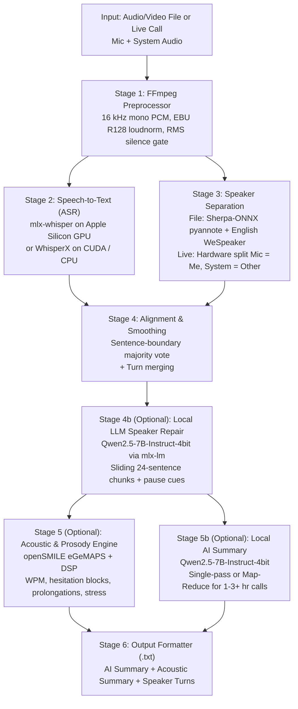

# VoiceDigest — Architecture Deep Dive

## 1. Overview

**VoiceDigest** is a 100% offline macOS desktop application and Python CLI for transcribing long-form audio/video files and live calls, separating speakers, extracting acoustic/prosodic biomarkers (speaking pace, hesitation blocks, vocal stress), and generating focused on-device AI summaries — with zero outbound network access during inference.

Architecturally, it pairs a native **SwiftUI** front-end and **macOS Core Audio** dual-stream capture engine with a deterministic multi-stage Python ML pipeline (`FFmpeg → MLX-Whisper → Sherpa-ONNX Diarization → Local Qwen2.5-7B Speaker Repair & Map-Reduce Summarization → openSMILE Prosody`). Sequential model unloading keeps peak RAM around **~2–5 GB** on Apple Silicon, air-gap privacy is enforced at the OS socket level, and the entire stack packages into a standalone drag-and-drop `VoiceDigest.dmg` with no external dependencies (no Ollama, no Homebrew, no Hugging Face tokens).

---

## 2. End-to-End Architecture

---

## 3. Component-by-Component Deep Dive

### A. Audio Capture & Preprocessing
* **Why convert `.m4a`/`.mp4` to 16 kHz mono PCM WAV via `FFmpeg`?**
  * Neural speech models cannot read compressed AAC/MP3 containers directly — they expect a raw 1D waveform array at 16,000 samples/second (`float32` / `int16`).
  * Decoding **once** up front lets all downstream stages (ASR, diarization, openSMILE, SER) share one exact timeline (preventing timestamp drift from AAC priming offsets) and enables **instant byte-offset seeking** (`byte = t × 16,000 × 2`) so prosody can read short turn slices without loading a 1-hour file into RAM.
* **Why EBU R128 Loudness Normalization (`loudnorm` to `-16 LUFS`)?**
  * Real-world call recordings are often `-40` to `-55 dBFS` (~30 dB quieter than studio speech). `loudnorm` raises speech uniformly to the configured target (`-24` to `-10 LUFS`, default `-16`) without amplifying silence or room tone (unlike dynamic range compressors such as `dynaudnorm`, which boost background hiss into false speech).
* **Native macOS 14.2+ Dual-Stream Live Call Capture (Zero Virtual Drivers):**
  * **Mic (`Me`):** Apple's `AVAudioRecorder` writes 16 kHz mono PCM directly to `mic.wav`, with explicit `AVCaptureDevice.requestAccess(for: .audio)` permission handling.
  * **System Audio (`Other`):** macOS 14.2's **Core Audio Process Tap** (`AudioHardwareCreateProcessTap`) wrapped in a private Aggregate Device streams Zoom/Meet/Teams audio into a direct pure-Swift 16 kHz PCM16 WAV writer — no BlackHole driver and no *Screen Recording* permission required.
  * **Zero-Collision Sessions & Cleanup:** Each call writes to `~/Library/Caches/VoiceDigest/sessions/<timestamp>_<uuid>/`, so Call #2 can record while Call #1 is still transcribing, followed by immediate auto-deletion on completion and an orphan sweep on launch.

### B. Speech-to-Text (ASR) — `mlx-whisper` vs. `faster-whisper`
* **What is ASR?** Automatic Speech Recognition — converting audio waveforms into text and word-level timestamps using an encoder-decoder Transformer (OpenAI Whisper).
* **Why `mlx-whisper` on Apple Silicon instead of `faster-whisper`?**
  * `faster-whisper` uses CTranslate2, which accelerates on NVIDIA CUDA but falls back to **CPU `int8`** on macOS, throttling fanless laptops and taking 15–20 minutes for a 1-hour call.
  * Apple's **MLX** framework runs Whisper natively on the **Apple Silicon Metal GPU** with unified memory, reducing a 1-hour `turbo` transcription to **~3 minutes** with much lower CPU heat.
* **Anti-Hallucination Safeguards:**
  * Whisper frequently hallucinates `"Thank you."` on silence. VoiceDigest enforces a two-layer defense: (1) an RMS silence energy gate (`RMS < 0.0005` ≈ `-66 dBFS`) before `loudnorm`/ASR, and (2) `condition_on_previous_text=False` + filtering segments with `no_speech_prob > 0.6`.

### C. Speaker Diarization ("Who Spoke When")
* **How neural diarization works:**
  1. **Segmentation** (`pyannote-segmentation-3.0`): detects speech activity and speaker change boundaries in sliding windows.
  2. **Speaker Embeddings** (`WeSpeaker VoxCeleb ResNet34-LM`): converts each speech chunk into a fixed-length vector ("voiceprint").
  3. **Clustering:** groups voiceprints into $K = N$ speaker clusters (`num_speakers`).
* **Why `sherpa-onnx` over `pyannote.audio` as the Mac app default?**
  * `pyannote/speaker-diarization-3.1` is gated behind a Hugging Face token, pulls in ~900 MB of PyTorch, and can suffer PyTorch MPS numerical clustering collapse on Apple Silicon.
  * `sherpa-onnx` runs `pyannote-segmentation-3.0` + English `WeSpeaker VoxCeleb ResNet34-LM` in **ONNX Runtime** (~32 MB total, zero HF token, fast on CPU, no PyTorch required in the `.dmg`). `pyannote.audio` remains available via CLI.
* **Sentence-Boundary Smoothing:**
  * Word-by-word speaker assignment causes isolated single-word flips mid-sentence due to 50–150ms timestamp jitter. Grouping words by sentence boundaries (`. ? !`) and taking a **duration-weighted majority vote** keeps every sentence intact.

### D. Local LLM Speaker Repair & Map-Reduce Summarization (`Qwen2.5-7B-Instruct-4bit`)
* **Why combine acoustic diarization with an LLM pass?**
  * Acoustic voiceprints struggle on single-mic compressed calls and ultra-short turns (`< 1.5s`). An LLM leverages conversational semantics (Q&A pairs, reciprocal greetings, pronoun perspective `"I/we"` vs. `"you"`, entity/role continuity).
* **Zero Text Mutation:**
  * The LLM **never rewrites transcript text**. It receives numbered sentences (with `[pause Xs]` cues) and outputs **only** a JSON map `{sentence_id: speaker_int}` under greedy decoding (`temp=0.0`), preserving every word and timestamp verbatim.
* **Bounded Context Window for 1–3+ Hour Calls:**
  * **Speaker Repair:** Sliding chunks of 24 sentences + 5 sentences of prior labeled `context` (~700 tokens/call — <3% of Qwen's 32K context window).
  * **Summarization:** Single-pass for short recordings ($\le 12,000$ chars); automatic **Map-Reduce** for long recordings (10,000-char chunk extraction → final deduplicated synthesis guided by the user's 160-char focus prompt).

### E. Acoustic & Prosodic Analysis (`openSMILE` + DSP)
* Extracts strictly non-lexical biomarkers that plain text loses:
  * **Speaking Pace:** Articulation WPM (`(last_word.end - first_word.start) - pauses_>=_0.4s`) and syllables/sec, flagging turns `> 175 WPM` or `> +1.5σ` above that speaker's session baseline.
  * **Acoustic Disfluencies:** Mid-clause silent blocks (`0.4s–1.5s`), word/phoneme prolongations (`>= 0.85s` and `> 3.5×` expected syllable duration), and syllable repetition energy bursts (`80–250ms` envelope peaks).
  * **Vocal Stress:** Per-speaker z-scored `openSMILE` eGeMAPS features ($F_0$ pitch mean, pitch jitter, spectral flux, rapid breath intakes) plus optional 8-second windowed SpeechBrain SER.

### F. Privacy, Memory & Packaging Engineering
* **Air-Gap Enforcement:** Sets `HF_HUB_OFFLINE=1` / `TRANSFORMERS_OFFLINE=1` before ML imports and patches `socket.socket.connect`, `create_connection`, and `getaddrinfo` to raise `OfflineNetworkError` immediately on any non-loopback network call.
* **Sequential Memory Management:** Peak RAM stays at **~2 GB** (or **~5 GB** with Qwen 7B) because each stage explicitly frees its model and calls `gc.collect()` + `mx.clear_cache()` / `torch.mps.empty_cache()` before loading the next stage.
* **Self-Contained Mac Packaging (`VoiceDigest.dmg`):** Native SwiftUI binary (~2 MB) spawns a PyInstaller-bundled MLX/Sherpa-ONNX/openSMILE sidecar + bundled `ffmpeg` (`~425 MB` `.dmg`, zero Python/Homebrew/Ollama required). Structured `@@PROGRESS@@ {...}` JSON lines over stdout drive the unified UI progress bar.

---

## 4. Engineering Challenges & Solutions

1. **Metal GPU OOM on Long Monologues (`kIOGPUCommandBufferCallbackErrorOutOfMemory`):**
   * *Root Cause:* Transformer self-attention in `wav2vec2` SER is $O(T^2)$ in sequence length; a multi-minute turn allocated gigabytes of attention matrix on MPS.
   * *Solution:* Bounded 8-second windowing (max 4 evenly spaced windows per turn) under `torch.no_grad()`, capping SER memory to `< 200 MB`.
2. **Speaker Collapse on Quiet Recordings (`-42 dBFS`):**
   * *Root Cause:* Raw call audio had an RMS of `0.006` (~30 dB below normal speech), compounded by PyTorch MPS clustering instability in `pyannote 3.1`.
   * *Solution:* EBU R128 `loudnorm` (`-16 LUFS`) + English WeSpeaker VoxCeleb ONNX diarization on CPU.
3. **LLM Anchoring Bias in Speaker Repair:**
   * *Root Cause:* Passing noisy `(audio_hint=speaker 1)` on every line caused the LLM to echo broken acoustic guesses rather than reason from dialogue structure.
   * *Solution:* Removed per-line acoustic hints, added `[pause Xs]` cues + a 1-shot example + greedy decoding (`temp=0.0`) + flexible JSON parsing.
4. **Silent `mic.wav` & Whisper `"Thank you."` Hallucinations:**
   * *Root Cause:* `AVAudioConverter`/`AVAudioFile` silently failed on Float32 non-interleaved mic buffers, missing explicit `AVCaptureDevice.requestAccess`, and Apple Silicon's lid-hinge hardware mic disconnect switch — followed by `loudnorm` boosting silence into Whisper.
   * *Solution:* Switched mic capture to native `AVAudioRecorder`, wrote a direct pure-Swift PCM16 WAV writer for system audio, added an RMS silence gate before `loudnorm`, and filtered high `no_speech_prob` Whisper segments.
5. **macOS `MenuBarExtra` Popover Resize Artifact:**
   * *Root Cause:* Dynamically removing a progress bar inside an open SwiftUI `MenuBarExtra(.window)` leaves stale height in the backing `NSPanel`.
   * *Solution:* Fixed-size popover (`290×260`) with a scrollable inner list so the window frame never shrinks dynamically.

---

## 5. Architectural Trade-Offs

| Decision | Chosen Option | Alternative | Rationale |
| :--- | :--- | :--- | :--- |
| **Pipeline vs. Agent** | Deterministic multi-stage pipeline (with optional LLM repair/summary) | Autonomous LLM agent loop | Predictable latency, zero runaway token loops, strict offline reliability. |
| **Apple Silicon ASR** | `mlx-whisper` (Metal GPU) | `faster-whisper` (CPU) or `whisper.cpp` | 5–10× faster and cooler than CPU `faster-whisper` on fanless Macs; seamless Python integration. |
| **Diarizer** | `sherpa-onnx` (English VoxCeleb) | `pyannote.audio 3.1` | Zero HF token, ~32 MB vs ~900 MB PyTorch, no MPS collapse; `pyannote` remains available via CLI. |
| **Live Call Mode** | Default: Process on Stop (with optional 60s rolling mode) | Continuous 2s streaming | 0% GPU/heat during Zoom/Meet calls + full-sentence `turbo` accuracy + zero boundary cuts. |
| **App Architecture** | Native SwiftUI + Python sidecar over JSON stdout | PySide6/Qt or full Swift rewrite | True native macOS UX (Core Audio Process Tap, `sharingType=.none`, ~2 MB UI) while reusing the Python ML ecosystem. |
| **Distribution** | Download public models on first run into `Application Support` | Bundle 2–6 GB weights inside `.dmg` | Keeps `.dmg` at ~425 MB instead of 6 GB, survives app updates, zero HF tokens needed. |

---

## 6. Frequently Asked Technical Questions

* **Is VoiceDigest an AI agent?**
  * Strictly speaking, no — it is a deterministic multi-stage ML pipeline with embedded LLM stages (speaker repair and map-reduce summarization). Adding a supervisor LLM that inspects diarization confidence or speaker-turn imbalance and autonomously decides whether to re-cluster, switch models, or invoke semantic repair would turn it into an agentic workflow.
* **Why run 100% locally instead of cloud APIs (Whisper API / Gemini / GPT)?**
  * Sensitive conversations (interviews, legal, healthcare, M&A, internal engineering) often have strict privacy or NDA requirements where uploading raw audio to third-party APIs is unacceptable. On-device execution with socket-level air-gap enforcement removes compliance friction completely and costs \$0 per hour of audio.
* **What limits scaling to 5-hour calls or 10+ speakers?**
  * Temp WAV files scale linearly (~115 MB/hr/channel, manageable at ~1 GB for 5 hrs), and acoustic diarization accuracy degrades past 4–5 speakers on a single mixed microphone. For 10-speaker enterprise calls, per-participant audio tracks (e.g., Zoom raw tracks or RTP streams) combined with a running speaker-profile memory across LLM chunks would be the next architectural step.
* **How does it behave on an 8 GB RAM Mac?**
  * Sequential unloading keeps ASR (`small` ~1 GB) + `sherpa-onnx` (~0.4 GB) + DSP prosody (~0.3 GB) well under 2 GB peak RAM. Only the optional `Qwen2.5-7B-4bit` (~5 GB) is tight on 8 GB machines, where switching to `Qwen2.5-3B-4bit` (~2.2 GB) is recommended.
